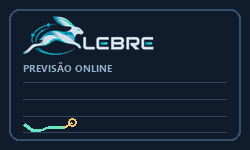
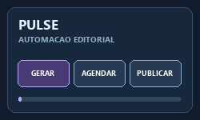
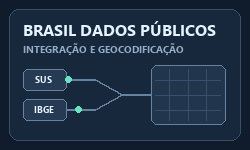
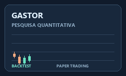
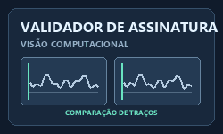

# Olá! Eu sou o Silvano  

  
  

 

> _"99,9% dados, 0,1% caos... mas se houver caos, a gente resolve com um `try-except` ou com agentes bem orquestrados."_ 😅

---

### 

Desde 2018, venho construindo uma trajetória que conecta **tecnologia, dados, inteligência artificial e impacto real em negócios**. Atualmente atuo como **Especialista de Inteligência Artificial**, com foco em **sistemas multiagênticos, IA Generativa, automação inteligente e arquitetura de soluções escaláveis**, especialmente em contextos corporativos e financeiros.

* **IA Generativa & Agentes:** Atuação com **RAG, LLM Orchestration, MCP/A2A, agentes autônomos e automação de fluxos críticos**, desenhando soluções robustas para cenários complexos.
* **Mercado Financeiro & Decisão Inteligente:** Experiência em aplicações de IA no setor financeiro, incluindo apoio à decisão, detecção de anomalias, automação e arquitetura de sistemas inteligentes.
* **Engenharia de Dados & Machine Learning:** Desenvolvimento de pipelines escaláveis, modelagem preditiva, NLP e visão computacional aplicados a problemas reais.
* **Pesquisa aplicada & reprodutibilidade:** Na LEBRE, investigo como adaptar modelos de previsão online a mudanças nas séries temporais, com experimentos pré-registrados e avaliações reproduzíveis.
* **Educação & Compartilhamento de Conhecimento:** Entusiasta da democratização tecnológica, busco transformar conhecimento técnico em soluções acessíveis, úteis e com impacto.

---

### 

<table border="0">
  <tr>
    <td width="250" align="center" valign="middle">
      
    </td>
    <td valign="top">
      
      
<b>Previsão online de séries temporais:</b> prevê um passo à frente e usa testes estatísticos sequenciais para decidir quando incluir ou remover entradas, com custo computacional fixo por passo. A pesquisa tem experimentos pré-registrados e avaliações reproduzíveis.

      
<a href="https://pypi.org/project/lebre/">PyPI</a> · <a href="https://github.com/Iquitim/lebre-research">Registro da pesquisa</a> · <a href="https://github.com/Iquitim/lebre-lab">Laboratório de experimentos</a>

      
      
      
    </td>
  </tr>
  <tr>
    <td width="250" align="center" valign="middle">
      
    </td>
    <td valign="top">
      
      
<b>Automação editorial com IA:</b> plataforma de código aberto e auto-hospedada para planejar, gerar e revisar conteúdo, agendar publicações e publicar em Bluesky, X e Threads. Suporta modelos locais via Ollama e provedores em nuvem.

      
<a href="https://github.com/Iquitim/pulse#demonstra%C3%A7%C3%A3o-da-interface">Demonstração da interface</a>

      
      
      
    </td>
  </tr>
  <tr>
    <td width="250" align="center" valign="middle">
      
    </td>
    <td valign="top">
      
      
<b>Data Engineering & Impacto Social:</b> Projeto voltado à unificação de bases massivas do SUS e IBGE com <b>PySpark</b> e geocodificação em larga escala. O objetivo é transformar dados públicos heterogêneos em inteligência socioeconômica estratégica para análises territoriais e tomada de decisão.

      
      
      
    </td>
  </tr>
  <tr>
    <td width="250" align="center" valign="middle">
      
    </td>
    <td valign="top">
      
      
<b>Quantitative Research & Intelligent Automation:</b> Hub experimental de pesquisa quantitativa com foco em <b>backtesting</b>, <b>paper trading</b> e exploração de sistemas inteligentes aplicados a trading. O projeto funciona como laboratório para validação de estratégias, automação e evolução de modelos com apoio humano no processo decisório.

      
      
      
    </td>
  </tr>
  <tr>
    <td width="250" align="center" valign="middle">
      
    </td>
    <td valign="top">
      
      
<b>Computer Vision & Fraud Prevention:</b> Solução de autenticação documental baseada em visão computacional, combinando <b>ResNet50</b>, extração profunda de características e <b>SVM</b> para apoiar prevenção a fraudes e validação biométrica comportamental.

      
      
      
    </td>
  </tr>
</table>

---

### 

  <strong>IA Generativa & Orquestração:</strong>
  
  
  
  
  

  <strong>Linguagens e Dados:</strong>
  
  
  
  

  <strong>Machine Learning & Visão:</strong>
  
  
  
  
  

  <strong>Cloud, BI & Infra:</strong>
  
  
  
  
  
  

  <strong>Ferramentas & Ambiente:</strong>
  
  
  
  

---

### 

* Sistemas **multiagênticos** para automação corporativa.
* Arquiteturas de **LLM Orchestration** com MCP e A2A.
* **RAGs** mais robustos, observáveis e escaláveis.
* Agentes aplicados a **mercado financeiro**, decisões e operações inteligentes.
* Fine-tuning e adaptação de modelos para cenários complexos de negócio.

---

### 

* IA Generativa, agentes e automação inteligente.
* Carreira em dados, arquitetura de soluções e ecossistema open-source.
* Tecnologia aplicada ao setor financeiro.
* Educação, acessibilidade e impacto social por meio da tecnologia.

 

---

> _"A tecnologia é mais poderosa quando aproxima as pessoas."_  
> — Tim Cook
